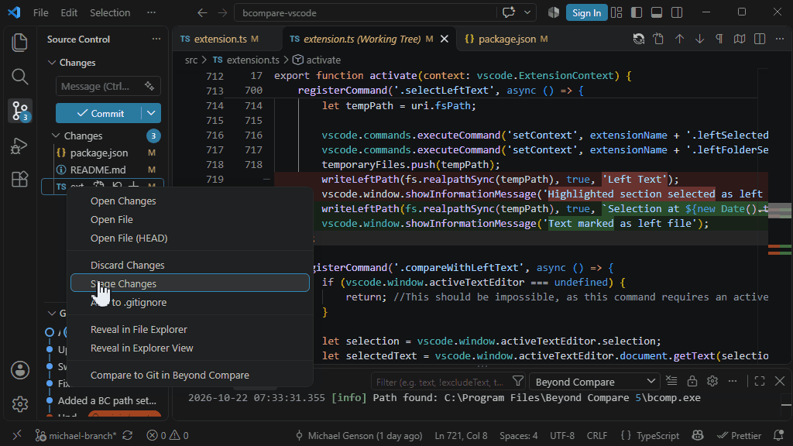

# Open Files in Beyond Compare Directly from VS Code

An intuitive extension to seamlessly launch [Beyond Compare](https://www.scootersoftware.com/) directly from the VS Code menus, sidebars, and open tabs

## Requirements

- **Beyond Compare** must be installed.
- **macOS Users:** The `bcomp` command line tool must be installed. In Beyond Compare, pick **Beyond Compare > Install Command Line Tools...** to enable it.
- Compatible with Visual Studio Code on Windows, macOS, and Linux

---

## Quick Demo

---

## Features & Usage

### File Comparisons

- **Open Files:** Right-click an open tab or a file in the Explorer view, and pick `Select Left File`. Then right-click a second file and pick `Compare to Left File`.
- **Multiple Items:** Select two files or folders in the Explorer view, right-click, and pick `Compare Selected Items`.
- **Live Edits:** Right-click an open tab with unsaved modifications and pick `Compare to Last Save`.
- **External Files:** Right-click an open file and pick `Compare to File...` to open a native file dialog. Then pick a file from the local system.

### Text & Clipboard Comparisons

- **Text Selections:** Right-click a selected block of text in an open tab and pick `Select Text as Left File`. Then right-click a second block of text and pick `Compare Text to Left File`. To compare a file with a block of text, pick the file first.
- **Clipboard Integration:** Right-click an open tab and pick `Compare to Clipboard`. Right-click a block of text and pick `Compare Text to Clipboard`.

### Folder Comparisons

- **Open Folders:** Right-click a folder in the Explorer view and pick `Select Left Folder`. Then right-click a second folder and pick `Compare to Left Folder`.
- **External Folders:** Right-click a folder and pick `Compare to Folder...` to open a native folder dialog. Then pick a folder from the local system.
- **Parent Folders:** Right-click an open file and pick `Compare Parent to Folder...` to open a native folder dialog. Then pick a folder from the local system to be compared with the folder containing the open file.

### Git Integration & Diff Auditing

- **Branch & Stage Audits:** Right-click files in the Source Control view and pick `Compare to Git in Beyond Compare` to instantly review modified files.
    - **Multi-State Flexibility:** Audit unstaged changes against the last commit, staged changes against the last commit, or new unstaged edits directly against the current staged changes.
- **Native Diff Upgrades:** Click the `Open Diff in Beyond Compare` button on the Diff Editor toolbar.

---

## Configuration

The extension works automatically if Beyond Compare is installed in its default system location. Configure the executable path in extension settings when using a portable version, custom directory, or experiencing issues launching Beyond Compare.

---

## Support

- **Bug Reports:** Submit unexpected behaviors or feature requests directly through our GitHub Issues page.
- **Email Support:** Contact the team directly at support@scootersoftware.com.
- **Debug Logs:** Verbose logging can by enabled by opening the Beyond Compare Output Channel and using the settings cogwheel panel inside VS Code.

---

## License

[MIT](LICENSE)
